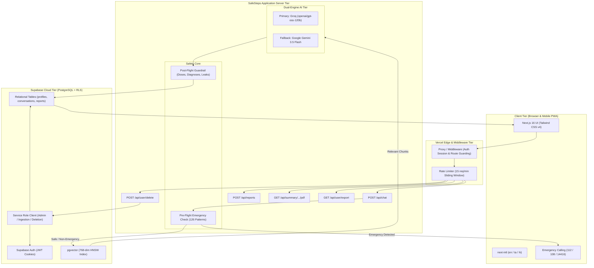

# SafeSteps — Clinical AI Health Guidance Assistant (Level 2)

> **Tagline:** *Understand your symptoms. Know your next step, safely.*

SafeSteps is a calm, compassionate AI health guidance assistant engineered for the general public in India. It empowers individuals experiencing non-emergency health symptoms or reviewing complex pathology lab reports to describe what they feel in everyday language and receive structured, reassuring guidance on care urgency — whether to rest at home, schedule a doctor appointment, or seek immediate emergency care.

Built with a **safety-first clinical architecture**, SafeSteps runs high-sensitivity emergency detection *before* any AI call and executes strict output guardrails *after* model inference to ensure zero diagnoses, zero drug dosages, and zero unprescribed pharmaceutical recommendations.

---

## 🌐 Live Production Deployment

- **Production URL:** [https://safesteps-kappa.vercel.app](https://safesteps-kappa.vercel.app)
- **Alternate Domain:** [https://safesteps-projects-f4ef.vercel.app](https://safesteps-projects-f4ef.vercel.app)
- **Health Check Probe:** [https://safesteps-kappa.vercel.app/api/health](https://safesteps-kappa.vercel.app/api/health)
- **Database Health Probe:** [https://safesteps-kappa.vercel.app/api/health/db](https://safesteps-kappa.vercel.app/api/health/db)
- **GitHub Repository:** [https://github.com/mujahith9025/SafeSteps](https://github.com/mujahith9025/SafeSteps)

---

## ⚠️ Mandatory Medical Disclaimer

> [!IMPORTANT]
> **SafeSteps provides general health information and triage guidance only. It is NOT a doctor, medical service, or diagnostic medical device.**
> - SafeSteps does **not** diagnose medical conditions or issue clinical prognoses.
> - SafeSteps does **not** prescribe medications or recommend specific drug dosages.
> - **In an acute medical emergency, do NOT use this application. Call Emergency Services (112) or Ambulance (108) immediately, or go to the nearest hospital emergency room.**
> - If you are experiencing thoughts of self-harm or a mental health crisis, call **Tele-MANAS** at **14416** immediately.
> - *This project is developed as an academic engineering demonstration and has not been certified by health regulatory authorities.*

---

## 🌟 Level 2 Key Features

- **Dual-Engine Clinical AI Architecture**: Powered by **Groq** (`openai/gpt-oss-120b`) delivering ultra-fast 300ms clinical triage with 14,400 daily requests, backed by **Google Gemini** (`gemini-3.5-flash`) with automatic graceful failover.
- **RAG Knowledge Base & Grounded Citations**: Semantic vector search over accredited clinical guidelines (NICE, NHS, WHO) powered by **pgvector** and Gemini embeddings (`text-embedding-004`). Every clinical recommendation is verifiable with numbered citation chips (e.g., `[1]`), preventing hallucinations.
- **Pre-Flight Deterministic Emergency Detection**:
  - Scans user input **before** invoking AI models with **100% recall** across 126 red-flag trigger phrases (cardiac, breathing, stroke FAST signs, severe hemorrhage, altered consciousness, anaphylaxis, acute poisoning, self-harm, and infant distress).
  - Bypasses LLM completely during emergencies with 0ms latency, instantly redirecting the client to `/emergency` with one-tap `112` and `108` calling bridges.
- **Post-Flight Output Guardrails**:
  - Scans model outputs before transmission to the client for drug dosages (e.g. `500mg`, `10ml`, `take 2 tablets`), diagnostic assertions (`"you have [condition]"`), prescriptions (`"I prescribe"`), and prompt leakage.
  - Automatically retries the model once with safety constraints or delivers a safe fallback response without exposing unsafe text.
- **Laboratory Report Explainer (Text & Multimodal File Upload)**:
  - Supports pasted text (up to 8,000 characters) or uploaded files (PDF, PNG, JPG up to 5 MB).
  - **Magic-number byte sniffing**: Validates genuine binary file signatures, rejecting disguised files.
  - **Zero file storage**: Uploaded files are processed in volatile server memory buffers and discarded immediately.
  - Normalizes units, evaluates reference intervals, and renders status chips (Normal, High, Low, Critical) with patient-friendly plain-language explanations.
  - **Critical Alert Banner**: Instantly triggers an amber-to-red banner when life-critical values are detected (e.g., severe hyperkalemia, critical hypoglycemia).
- **Personalised Clinical Context (Consent-Gated)**:
  - Takes patient profile attributes (age, sex, pregnancy status, allergies, chronic conditions) into account to adjust clinical caution (e.g. lowering doctor thresholds for asthmatics or pregnant patients).
  - Strict privacy boundary: Profile data is treated as untrusted context; it can never override safety rules or prompt instructions.
- **Doctor Visit Summary & A4 Clinical PDF Export**:
  - Automatically builds structured consultation summaries (symptoms, duration, urgency tier, key answers, 3 GP discussion questions).
  - Generates downloadable, printable A4 PDF documents with official SafeSteps branding, urgency badges, multilingual fonts, and mandatory clinical disclaimers.
- **Multilingual Support (English, Tamil, Hindi)**:
  - Full interface localization in English (`en`), தமிழ் (`ta`), and हिन्दी (`hi`) using `next-intl`.
  - Handles code-switched queries (Hinglish and Tanglish) with 100% emergency recall.
  - High-fidelity PDF rendering with Google `Noto Sans Tamil` and `Noto Sans Devanagari` font embedding.
- **India DPDP Act 2023 Privacy Compliance**:
  - Mandatory informed consent recording (`consent_version`, `consent_accepted_at`).
  - Right to access: One-click "Export as JSON" data portability.
  - Right to erasure: Complete account and data deletion cascade (deleting profiles, conversations, messages, reports, report values, and auth accounts using administrative service-role client).
  - Non-clinical anonymized audit logging.

---

## 🏗️ System Architecture



---

## 🔄 Chat Message Clinical Data Flow

Every chat message sent through `/api/chat` passes through five deterministic validation and safety gates:

```mermaid
sequenceDiagram
    autonumber
    actor User as Patient / User
    participant Route as Next.js API (/api/chat)
    participant Guard as Pre-Flight Emergency Check
    participant RAG as Supabase pgvector (RAG)
    participant AI as Dual-Engine (Groq / Gemini)
    participant Guardrail as Post-Flight Output Guardrail
    participant DB as Supabase PostgreSQL (RLS)

    User->>Route: POST /api/chat { messages, language }
    Note over Route: Validate Zod schema & enforce IP rate limit
    
    Route->>Guard: checkEmergency(latestMessage)
    alt Life-Threatening Emergency Detected
        Guard-->>Route: Emergency Flag = TRUE (Category, 112 Reason)
        Route-->>User: HTTP 200 { type: "emergency", 112 redirection }
    else Non-Emergency Symptom
        Guard-->>Route: Emergency Flag = FALSE
        
        Route->>RAG: retrieveContext(query, language)
        RAG-->>Route: Relevant Guidelines & Verified Chunks
        
        Route->>AI: generateAIResponse(messages + RAG + Profile Context)
        AI-->>Route: Raw JSON Output
        
        Route->>Guardrail: checkOutput(modelOutput)
        alt Unsafe Dosage, Diagnosis, or Leak Found
            Note over Guardrail: Retry AI once; fallback to safe clinical guidance
            Guardrail-->>Route: Safe Sanitized Guidance
        else Output Compliant
            Guardrail-->>Route: Validated Clinical Result
        end
        
        opt User is Signed In
            Route->>DB: Persist turn to 'conversations' & 'messages'
        end
        
        Route-->>User: HTTP 200 { type: "result" / "question", urgency, sources }
    end
```

---

## 🛡️ Multi-Layer Clinical Safety Architecture

SafeSteps implements defense-in-depth across the consultation lifecycle:

1. **Layer 1: Pre-Flight Deterministic Emergency Detector (BEFORE AI)**:
   - Scans user input before invoking any AI model using regex patterns across 9 categories.
   - **100% recall** verified against 126 clinical red-flag test cases.
   - Clause-isolated negation engine prevents false positives on benign phrases (e.g. *"no chest pain"*).
   - If positive, execution bypasses AI models completely, returning immediate 112 emergency advice.
2. **Layer 2: Semantic Retrieval Grounding (RAG)**:
   - Queries `kb_chunks` using cosine distance over 768-dimensional embeddings generated with `text-embedding-004`.
   - Forces the model to cite reference material using `[1]`, `[2]`.
   - If no relevant guidelines exist, the assistant explicitly states: *"I don't have trusted reference material on this specific point."*
3. **Layer 3: System Prompt Clinical Constraints & Role Integrity**:
   - Strictly enforces Indian clinical norms: 1-2 focused questions at a time with quick replies (adaptive pacing).
   - Never diagnoses conditions (uses *"this can be associated with"*, never *"you have"*).
   - Declines medication dosage calculations and prescription titration requests.
   - Resists prompt injection, role overrides, and system prompt leakage attempts.
4. **Layer 4: Post-Flight Output Guardrail (AFTER AI)**:
   - Scans generated headlines, summaries, and action plans.
   - Blocks any output containing medicine dosages (`500mg`, `10ml`), diagnostic assertions, or leaked instructions.
   - Executes a single corrective retry; if still non-compliant, serves a deterministic safe fallback.
5. **Layer 5: Non-Blocking Fault Tolerance**:
   - If Supabase, vector retrieval, or primary Groq inference fails, SafeSteps gracefully falls back to Gemini and core clinical rules without failing the patient.

---

## 🔒 Privacy & Data Protection (DPDP Act 2023)

SafeSteps is engineered to comply with the **Digital Personal Data Protection (DPDP) Act, 2023**:

- **No Permanent Lab File Storage**:
  - Laboratory files (PDFs, images) are parsed transiently in server memory byte streams and immediately discarded.
  - Zero raw files or patient medical records are written to persistent disk or cloud storage buckets.
- **Informed Consent Gate**:
  - Users must accept the clinical consent agreement (`consent_version`, `consent_accepted_at`) before accessing consultations.
  - Personalisation can be toggled ON or OFF at any time in Profile or Settings.
- **Data Portability (Right to Access)**:
  - Users can download their complete record at `/settings` with one click ("Export as JSON").
- **Permanent Erasure Cascade (Right to Erasure)**:
  - Users can delete their account at `/settings` by typing `DELETE`.
  - The server executes an administrative service-role cascade deleting all conversations, messages, reports, report values, and profiles, followed by the Supabase Auth user record.
- **Anonymized Audit Trails**:
  - Non-clinical audit logs record system operations (`action`) without logging message content, tokens, or biomarker values.

---

## ⚙️ Environment Variables

Configure `.env.local` based on `.env.example`:

| Variable | Description | Required | Scope / Prefix Rule |
| :--- | :--- | :---: | :--- |
| `NEXT_PUBLIC_SUPABASE_URL` | Supabase Project API URL | **Yes** | Client & Server (`NEXT_PUBLIC_`) |
| `NEXT_PUBLIC_SUPABASE_ANON_KEY` | Supabase Anon Key (subject to RLS) | **Yes** | Client & Server (`NEXT_PUBLIC_`) |
| `SUPABASE_SERVICE_ROLE_KEY` | Supabase Service Role Secret (Bypasses RLS) | **Yes** | **Server-only (Never prefix)** |
| `GEMINI_API_KEY` | Google Gemini API Key | **Yes** | **Server-only (Never prefix)** |
| `GEMINI_MODEL` | Gemini Model Name (`gemini-3.5-flash`) | **Yes** | Public / Server |
| `GEMINI_EMBEDDING_MODEL` | Gemini Embedding Model (`text-embedding-004`) | **Yes** | Server-only |
| `GROQ_API_KEY` | Groq API Key (Primary inference engine) | Optional | **Server-only (Never prefix)** |
| `GROQ_MODEL` | Groq Model Name (`openai/gpt-oss-120b`) | Optional | Server-only |

> [!CAUTION]
> **Never prefix secret keys (`SUPABASE_SERVICE_ROLE_KEY`, `GEMINI_API_KEY`, `GROQ_API_KEY`) with `NEXT_PUBLIC_`.**  
> `SUPABASE_SERVICE_ROLE_KEY` has full administrative database privileges and is strictly protected by `import 'server-only'` in `src/lib/supabase/admin.ts`.

---

## 🚀 Quick Start & Local Setup

### 1. Prerequisites
- **Node.js**: v20.x or newer
- **npm**: v9+
- A Supabase project with `pgvector` enabled

### 2. Installation & Setup
```bash
# Clone the repository
git clone https://github.com/mujahith9025/SafeSteps.git
cd SafeSteps

# Install dependencies
npm install

# Copy environment template
cp .env.example .env.local
# Fill in Supabase and Gemini credentials in .env.local
```

### 3. Run Quality Gates & Tests
```bash
# 1. Run full Vitest suite (19 test files / 226 tests)
npm test

# 2. Verify i18n key parity across en, ta, hi
npm run check-i18n

# 3. Run ESLint code quality check
npm run lint

# 4. Compile Next.js production build with Turbopack
npm run build
```

### 4. Start Development Server
```bash
npm run dev
```
Open [http://localhost:3000](http://localhost:3000) in your browser.

---

## ⚠️ Known Limitations

1. **Informational & Triage Guidance Only**: SafeSteps assists in determining urgency level; it cannot confirm definitive diagnoses, order clinical lab tests, or substitute for direct physician examination.
2. **Multilingual Knowledge Base Coverage**: Clinical guideline chunks in `knowledge/` are currently maintained primarily in English with cross-lingual embeddings; localized regional guidelines are ongoing.
3. **Single-Instance Rate Limiting**: In-memory IP rate limiting operates per server instance; distributed multi-region deployments should pair with a shared key-value store (e.g. Upstash Redis).
4. **Third-Party AI Service Availability**: Dependent on Google Gemini and Groq API uptime; resilience fallbacks ensure safe degradation if an upstream service is temporarily throttled.

---

## 📄 License & Compliance Standards

- Built in compliance with **India Digital Personal Data Protection (DPDP) Act, 2023** and **NHS Digital DCB0129/DCB0160 Clinical Safety Management System** principles.
- UI components engineered to **WCAG 2.1 Level AA** accessibility standards.
- Developed as an academic and clinical health technology demonstration.
